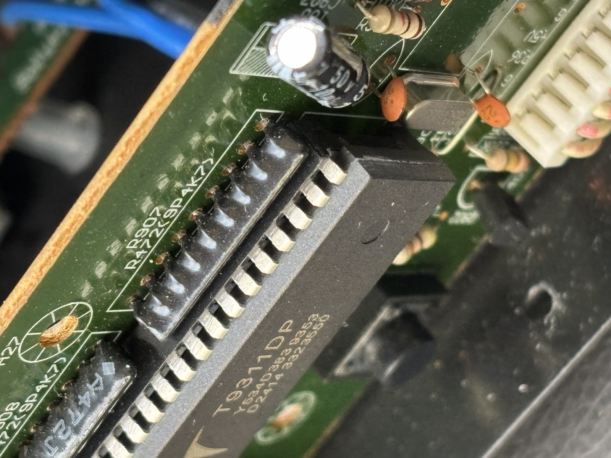
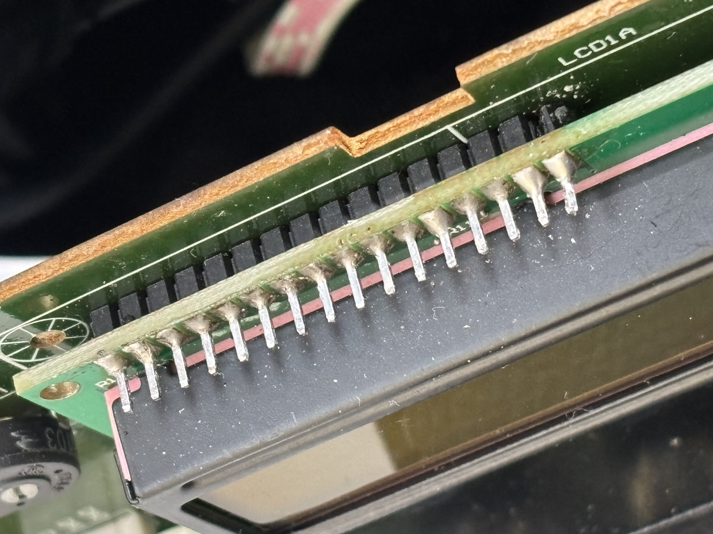
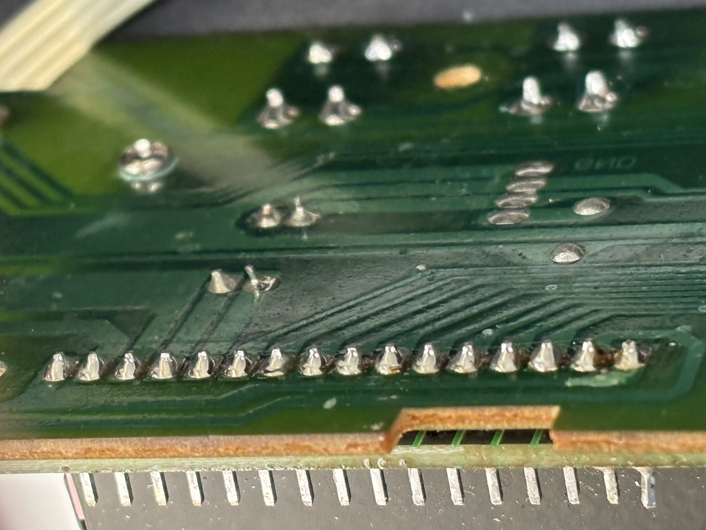

# Como o Pico pode mudar o texto do display do amp (opções de interceptação)

Análise de 2026-10-23. **Ainda não há decisão**: o dono está pensando.

Para **só ler** o estado e publicar no Wi-Fi (etapa 4), nada disso é necessário. O Pico apenas escuta os pinos do display,
como nas capturas. As pontas dos pinos, que sobram acima da placa do display (ver foto abaixo), aceitam
**Dupont fêmea** direto, sem solda.

Para **mudar o texto** (etapa 6: "Turntable", textos ao ligar), o Pico precisa ficar **no meio** entre o controlador e o
display.

## Por que "sobrescrever em paralelo" não funciona

A ideia era deixar tudo ligado como está e o Pico reescrever o display logo depois do controlador, rápido o bastante
para ninguém perceber. Isso não dá, por motivo elétrico:

- **E (perna 28, P2.7):** no repouso, o controlador segura o E em 0 com força. A porta é quase-bidirecional e puxa
  para 0 com um transistor. Se o Pico levantasse o E, os dois brigariam pelo fio: o Pico perderia, e o Pico ou o
  controlador poderiam se danificar.
- **Dados (pernas 32–39, P0):** no repouso, ficam presos no último byte escrito (capturas). Os bits em 0 são segurados
  com força pelo controlador; os resistores de 4,7 kΩ (R907/R908) só puxam para 5 V os bits em 1. O Pico conseguiria
  baixar uma linha, mas não levantar.

Não existe uma janela em que o Pico escreva sozinho sem brigar com o controlador.

## O que as fotos mostraram

| Foto | O que mostra |
|---|---|
|  | O T9311 está **soldado direto na placa, sem soquete** |
|  | O display está preso por uma barra de 16 pinos, soldada nas duas placas, com um **espaçador de plástico** entre elas. As pontas dos pinos sobram acima da placa do display |
|  | No lado das soldas, sai **uma trilha de cada pino**, ainda separadas umas das outras logo depois da solda. Mais adiante elas se juntam num feixe fino até o controlador |

## Opções

| # | Opção | Veredito |
|---|---|---|
| 1 | Adaptador no lugar do controlador (soquete "sanduíche" de 40 pinos) | **Descartada**: o chip está soldado; seria preciso desoldar 40 pernas |
| 2 | **Cortar 11 trilhas** no lado das soldas, logo depois dos pinos do display | **A menos intrusiva**: o display não é tocado nem desoldado, e nada muda de lugar no painel |
| 3a | Cortar os pinos entre as placas | **Inviável**: o espaçador de plástico não deixa o alicate entrar |
| 3b | Desoldar as 16 soldas de baixo e soltar o display com a barra de pinos, que fica presa a ele; soldar uma barra fêmea na placa | Possível, mas o display ficaria mais alto (a altura da plaquinha do Pico), e talvez não caiba atrás da janela do painel |

## Opção 2 em detalhe: cortar trilhas

```
ANTES:  controlador ───────────trilha────────────── display

DEPOIS: controlador ───── ✂ ───────────────── display
             │       (corte)                     │
             └──fio──► Pico ──fio────────────────┘
          (solda na perna        (Dupont na ponta do pino,
           do T9311, embaixo)     em cima do display)
```

1. **Cortar 11 trilhas** com estilete, 1 a 2 mm depois da solda de cada pino do display: pinos 4 a 14 (RS, RW, E, D0–D7).
   Não mexer nas trilhas do GND (1), +5 V (2), contraste (3) e luz (15, 16).
2. **Lado do controlador:** um fio soldado em cada perna do T9311 correspondente, pelo lado das soldas:
   RS = 10, RW = 11, E = 28, D0–D7 = 39–32 (mapa em `ligacao-analisador.md`). Essas soldas são grandes e fáceis.
3. **Lado do display:** Dupont fêmea nas pontas dos pinos 4–14, em cima da placa do display. Sem solda.
4. **Para voltar ao original:** uma gota de solda ou um pedacinho de fio sobre cada corte.

Cuidados:
- O risco principal é cortar uma trilha vizinha. Corte onde as trilhas estão separadas (logo depois da solda), com lupa
  ou com a câmera do celular. Faça dois cortes paralelos e retire o cobre do meio.
- Depois de cada corte, confira com o multímetro (continuidade): entre o pino do display e a perna do controlador não
  pode mais apitar, e entre trilhas vizinhas também não.
- O display não recebe calor nem esforço.

Ainda falta, antes de cortar:
- Escrever um roteiro passo a passo: ordem dos cortes, medições antes e depois, e como desfazer.
- Parte elétrica da etapa 6: o Pico precisa responder às leituras do busy flag (puxando as linhas para 0, sem levantar,
  já que o P0 tem pull-ups de 5 V). As entradas do Pico vindas do controlador são de 5 V; elas só aguentam isso com o Pico
  alimentado, então a alimentação pelo 5 V do amp (pino 2 do display, com diodo) precisa ser pensada junto.
  Considerar resistores em série nessas entradas.
